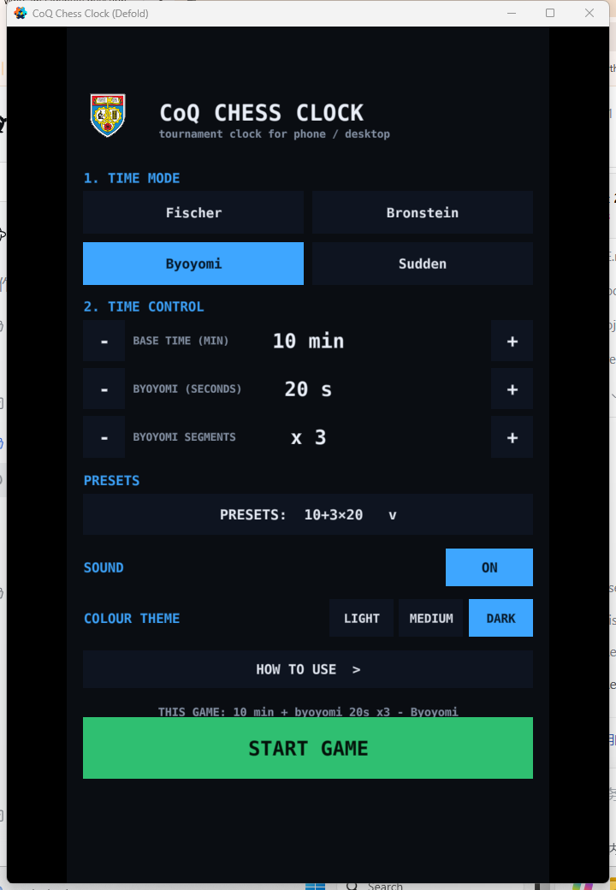
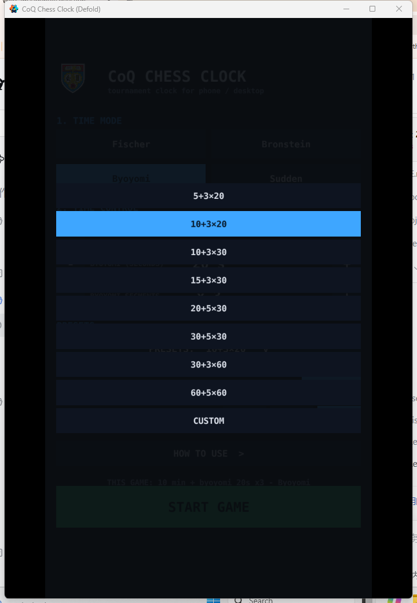
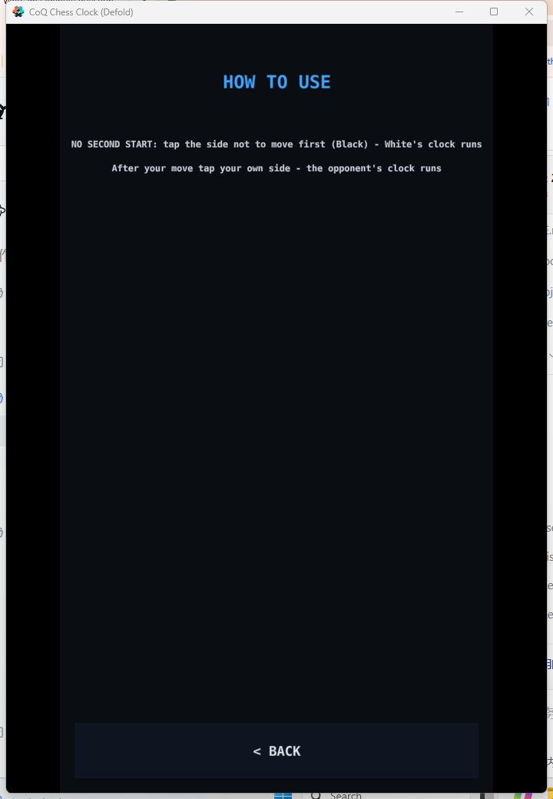
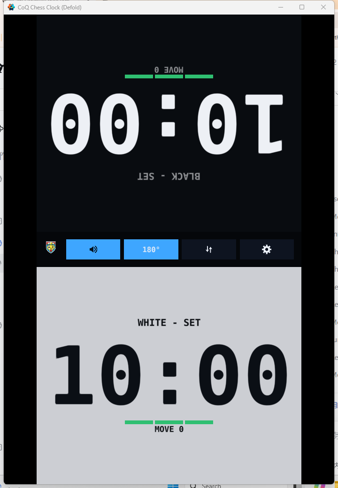
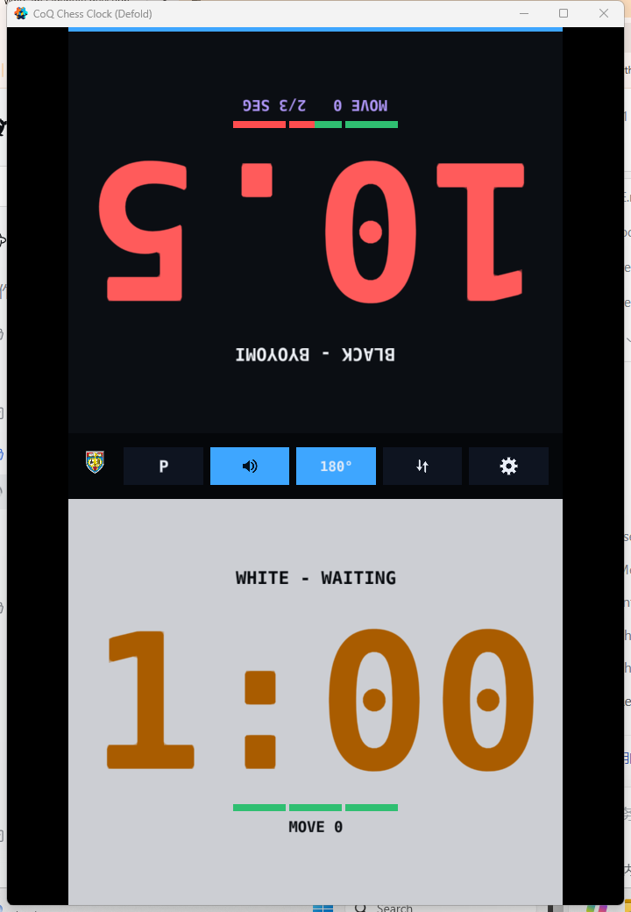
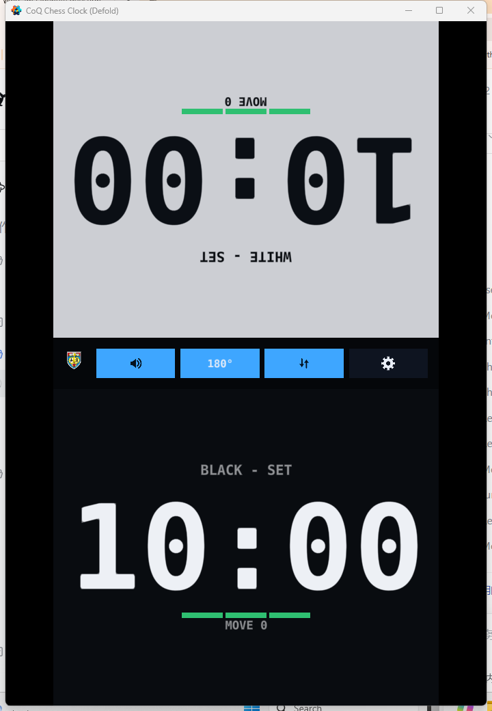
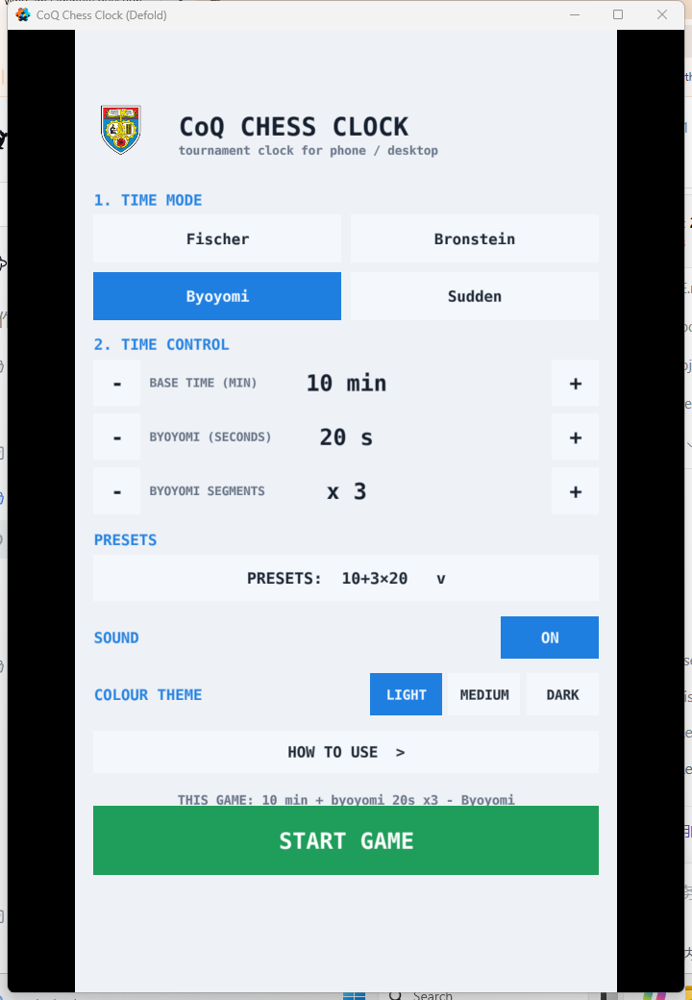
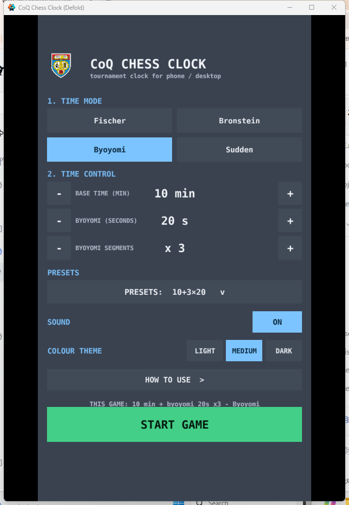
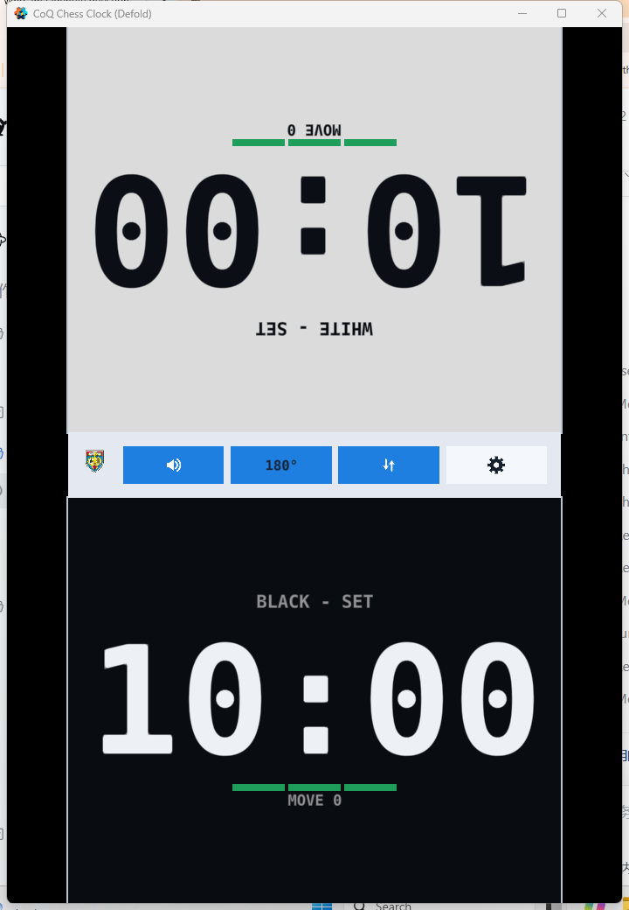
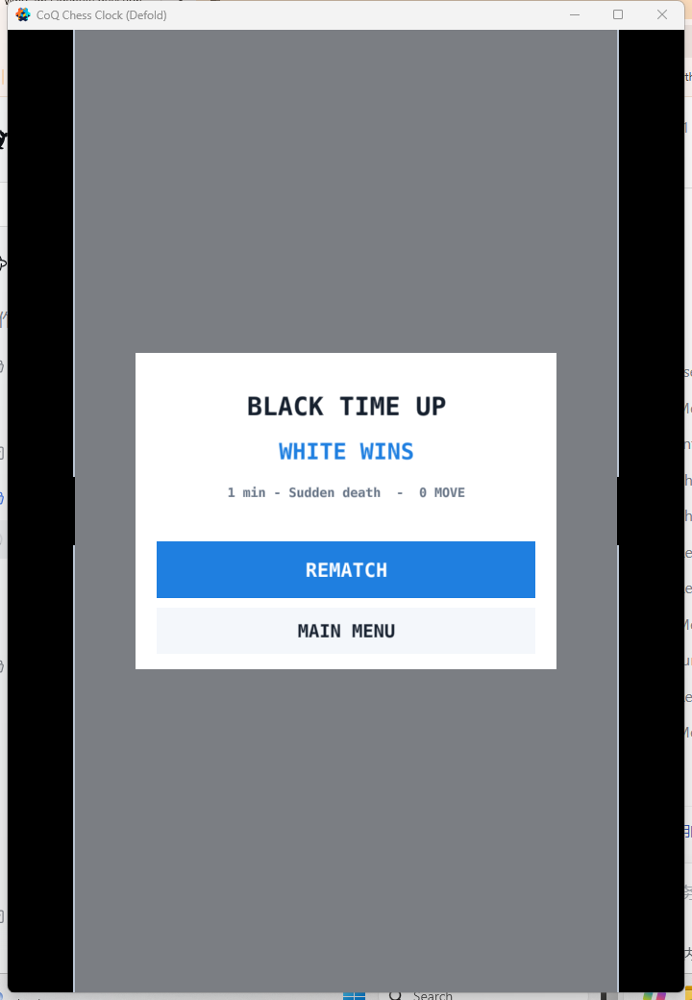

# CoQ 棋钟 · Defold 版

> 网页版说明：[English](../README.md) · [华文](../README_CN.md)

这是仓库根目录那个网页棋钟的 **Defold（Lua）移植版**：同一个产品、同一套计时语义，
换成游戏引擎实现，可以打包成 Windows / macOS / Linux / Android / iOS / HTML5 原生应用。

> ### 📱 关于用途与测试程度（实话实说）
>
> **手机才是目标设备**：要在手机上开一局，先用**网页版**（添加到主屏幕即可）；要装一个安卓原生应用，
> 用 **[Godot 版](../Godot/README.md)**（它有能力打出安卓 APK）。这一版同样能在手机上跑，但它是三者里
> **测试最少**的一版 —— 引擎与设置的单测都过、截图也人工核对过，但没有无头界面测试套件，
> 界面只靠截图 + 一次脚本化点击回归验证。
> 在电脑上跑（`tools/build_and_run.ps1`、截图、点击回归）属于开发与测试，不是主要用途。

计时逻辑在 `logic/engine.lua` 里是**纯 Lua、无引擎依赖**的模块，与网页版的 `engine.js`
一一对应（连常量都做了自动比对测试），因此两个版本的行为不会漂移。












---

## 一、已验证到什么程度（先读这个）

我没有只"写完就交"，凡是这台机器能跑的都真跑了：

| 验证项 | 方法 | 结果 |
| --- | --- | --- |
| 计时语义（加秒 / 延时 / 读秒 / 超时） | `lua logic/engine_spec.lua`（与网页版一一对应的 31 个用例，Lua 5.1.5 执行） | **31/31 通过** |
| 资源格式 + Lua 编译 | Defold 1.13.1 自带命令行构建器 `bob` | **build exit 0** |
| 打包成可执行程序 | `bob bundle --platform x86_64-win32` | **生成 ChessClockDefold.exe** |
| 运行期正确性 | 运行打包产物 10 秒，读 `log.txt` | **无 ERROR:SCRIPT**；日志确认两个界面都构建成功、计时源是 `socket.gettime` |
| 界面外观 | `tools/screenshot.ps1 -Scene menu / preset-open / help / clock / clock-byoyomi / clock-swapped` + `-Theme light/medium/dark` | 布局、旋转、配色、按钮、`180°` 与图标均正确；**预设下拉浮层**与**「怎么用」单独一页**也都拍过；交换两侧后被旋转的是另一块；三套主题下的设置页与棋钟页都已核对（见上面第 1–9 张图） |
| **输入链路（真实点击）** | `tools/click_test.ps1` 往窗口注入真实鼠标点击 | 一次完整通过：模式按钮、START GAME、**拍对侧开表**（`side=b target=w result=start`）、走一手、交换两侧、P/C 暂停继续全部生效（见第五节；这台机器上注入点击偶尔会被系统吞掉，脚本会重试） |
| **超时结算层** | `tools/screenshot.ps1 -Scene overlay`（1 分钟无加秒 + 键盘 A 开表，等 60 秒） | 结算卡片正常弹出：`BLACK TIME UP / WHITE WINS / 1 min - Sudden death - 0 MOVE`，见 `tests/screenshots/overlay.png` |
| **字符字形覆盖** | 解析 Defold 内置字体 `vera_mo_bd.ttf` 的 cmap + 静态校验 | `°` `×` 有字形（继续用文字）；`⇵` `⛶` `⚙` `🔊` **没有**，图标按钮已改成 PNG（见第七节） |
| 工程静态一致性 + 设置单测 | `node tests/run.js` | **20/20 通过**（静态 18 + Lua 单测入口 2；引擎用例 31/31、设置用例 13/13，见第五节） |

**还没验证的**（需要真机或编辑器，属于你接下来要做的事）：

* 真机触摸手感、iOS/Android/HTML5 的导出与实机表现；
* 极端分辨率/宽高比下的排版（设计基准 720×1280，已做自适应与 `window_resized` 重排）；
* Defold 编辑器里首次打开时的资源导入（`bob` 已经说明格式没问题，但编辑器可能提示重建缓存，属正常）。

---

## 二、怎么跑起来

### A. 用 Defold 编辑器（推荐）

1. 装 [Defold 1.13+](https://defold.com/download/)；
2. 编辑器里 `File → Open Project…`，选本目录的 **`game.project`**；
3. 按 `F5`（或 `Project → Build and Run`）。

命令行入口脚本 **`tools/build_and_run.ps1`** 需要本机已装过 Defold（它会自动从
`%LOCALAPPDATA%\Defold\installations.json` 找到 bob 与内置 JDK）。

### B. 只用命令行（不打开编辑器）

```powershell
powershell -ExecutionPolicy Bypass -File tools/build_and_run.ps1
```

它会依次：`bob --archive build`（编译全部资源与 Lua）→ `bob bundle`（打包）→
运行产物 10 秒 → 读 `log.txt`，最后打印 `RESULT: ...`。这是 CI 式的完整校验。

### C. 导出到手机 / 网页

编辑器 `Project → Bundle…`，选 Android / iOS / **HTML5** 等平台即可。
命令行的等价做法是 `bob bundle --platform js-web`（HTML5）或 `--platform arm64-android`，
发布版记得加 `--variant release`（此时不会写日志）。

### D. 运行期开关（打包产物直接加 `--config=…`）

| 开关 | 作用 |
| --- | --- |
| `chessclock.autostart=1` | 跳过设置页，直接进棋钟界面（冒烟测试 / 截图用） |
| `chessclock.debug_input=1` | 把输入、布局坐标、窗口事件打进日志（`tools/click_test.ps1` 依赖它） |
| `chessclock.reset_settings=1` | 忽略存档、回到首次启动的默认设置并写回（自动化测试用，避免上一轮的选择串味） |
| `chessclock.demo_quick=1` | 把时间调成 1 分钟无加秒（验证超时结算层时不用等 10 分钟） |
| `chessclock.demo_swapped=1` | 打开「交换两侧」（截图里验证「旋转跟着视觉上第一块」） |
| `chessclock.demo_theme=light` | 指定界面主题（`light` / `medium` / `dark`），截图时用 |
| `chessclock.demo_page=help` | 启动直接打开「怎么用」那一页（截图 / 目视核对用） |
| `chessclock.demo_preset_open=1` | 启动就把时间预设的下拉浮层展开（截图 / 目视核对用） |
| `chessclock.demo_byoyomi=1` | 开局直接摆一副读秒残局（1 分钟主时间 + 20 秒×3 段，并假装已走 86 秒），用来拍「段数条变红一段」 |

### E. 没声音怎么查（按顺序，5 分钟能定位）

棋钟的三种音效（走子 / 读秒滴答 / 超时警报）全部走 Defold 的 sound 组件，路径可以逐段核对：

1. **开关**：设置页 SOUND = ON，详情看操作条上的喇叭图标（静音是"喇叭 + 叉"那张）；
   启动日志里也会写 `sound=on`。
2. **代码有没有真的去播**：`--config=chessclock.debug_input=1` 跑一局，日志里会出现
   `DBG clock play #sfx_click`（走子）/ `#sfx_tick` / `#sfx_alarm`。
   什么都没打印 → 是开关或触发条件的问题，不是音频。
3. **引擎能不能出声**：跑自检脚本（会依次播 click → tick → alarm，间隔 1.2 秒，
   并把日志里对应的行与结论一起打印出来）：

   ```powershell
   powershell -ExecutionPolicy Bypass -File tools/sound_test.ps1
   ```

   等价的手工写法（注意 PowerShell 里**路径带引号时必须用调用运算符 `&`**，
   直接写 `"xxx.exe" --config=…` 会被当成字符串表达式，报 `Unexpected token`）：

   ```powershell
   cd "bundle\CoQ Chess Clock (Defold)"          # 进到 exe 所在目录（日志也写在这里）
   & ".\CoQChessClockDefold.exe" --config=chessclock.test_sound=1
   ```

   这一步还听不到，就与棋钟代码无关了，接着看第 4、5 条。
4. **系统输出**：确认 Windows 的默认播放设备是真接了音箱/耳机的那个。
   （实测这台机器默认是 `DigitalOutput`（数字/HDMI 输出）——如果音箱接在别的设备上，
   所有程序都会没声音。）顺便在「音量合成器」里确认这个 exe 没被单独静音。
5. **对照实验**：一个最小的 Defold 工程（一个 script + 一个 .sound + 一个 wav）在这台机器上
   同样发不出声音：Windows 的音频会话列表里**没有该进程的会话**，默认输出端口的峰值一直是 0，
   而用系统播放器播同一个 wav 峰值是 0.717 —— 说明问题出在引擎的音频输出这一层。

> `game.project` 里的 `write_log_file = 2` 表示"总是写日志"：打包产物会在启动目录留一份很小的
> `log.txt`。这是有意的——自动化验证要靠它核对行为，比赛现场出问题时用户手边也直接有一份日志。
> 想安静就改成 `1`（仅调试版），但那样 `tools/click_test.ps1` 会读不到日志。

---

## 三、操作方式

**没有「开始」按钮**——开局和实体棋钟一样，靠拍面板。

| 操作 | 说明 |
| --- | --- |
| 开局：拍**对侧**那半屏 | 白先走，所以拍**黑方**那一侧 → **白方的钟开始走**；这一下**不算步数**（两边仍是 0/0） |
| 拍自己那半屏 | 走完一手：时间立刻交给对方（拍非走棋方不产生任何效果） |
| 触摸 / 鼠标 | 都映射到同一个 `press` 动作，按坐标判断按的是哪一侧 |
| `A` / `L` | 键盘模拟白方 / 黑方按键（电脑上当棋钟用时很方便） |
| `空格` | 暂停 / 继续（未开表时是空操作） |
| `F` | 对坐模式开关（把视觉上第一块面板整体旋转 180°） |
| `ESC` | 返回设置页 |

设置页的「COLOUR THEME」是**浅色 / 中性 / 深色**三选一（与网页版的下拉框同一套色值、
同一套语义：两块对局面板始终「黑方深、白方浅」），选择会存进存档。

**时间预设是一个下拉框**（与网页版、Godot 版一致的界面决策）：一颗按钮显示当前档位，
点开以后铺一层浮层列表（棋类 11 档 / 读秒 8 档），最后多一档「CUSTOM / 自定义」——
自己用 `-` / `+` 改过数字、对不上任何一档时，下拉框就停在它上面。点浮层以外的地方会关掉浮层。

**「怎么用」是单独一页**：设置页底部那一行 `HOW TO USE >` 点进去，页里是原来那两条说明 +
底部一颗返回按钮（`self.page = "setup" | "help"`，切页走的是和换主题一样的整屏重建）。

中间操作条（与网页版同序）：**`P` / `C`**（暂停 / 继续，**未开表时整颗隐藏**）、
声音图标（开 / 关两态）、**`180°`**（对坐）、**交换两侧图标**（两块面板上下对调）、**齿轮图标**（返回设置）。

* **对坐模式**：默认开启，**视觉上第一块**（默认上半屏 = 黑方）整体旋转 180°，
  坐在对面的选手看到的是正的；手机上平放两人对坐时就这样用。
  把手机立起来给裁判/观众看时，按 `F` 或点 `180°` 关掉即可。
* **交换两侧**：只交换两块面板在屏幕上的**位置**（竖屏即上下互换），不改朝向；
  旋转永远跟着「视觉上第一块」走，所以交换后被旋转的是另一块（与网页版的 `.is-far` 同一套规则）。
  这个选择会存进存档，下一局仍然有效。
* **两个时间可以为 0**：读秒模式下**基础时间**与**读秒秒数**各可以是 0（但不能同时是 0）——
  0 主时间 = 纯读秒，0 秒读秒 = 只有主时间、用完即负（段数条隐藏）；
  两个都是 0 时按 1 分钟主时间兜底。
* **读秒阶段**：数字转紫，步数行显示剩余段数（如 `2/3 SEG`），最后 10 秒每秒滴答一次（主时间阶段同样如此，四种模式通用）；
  **数字与步数行之间还有一条分段指示条**：一段 = 一段读秒，绿 = 还没用、红 = 已经用掉；正在倒计时的那一段按本窗口剩余比例由绿变红（剩 5/20 秒 → 75% 红）。
  只在 Byoyomi 模式出现；对坐模式下整条跟着面板转 180°，对面选手看到的仍是「自己这边的数字下方」。
* **超时**：停表 + 警报音 + 结算层（`REMATCH` / `MAIN MENU`）。

---

## 四、目录结构与架构

```
Defold/
├── game.project              工程配置（分辨率、入口集合、输入绑定、写日志策略；无第三方依赖）
├── input/game.input_binding  触摸 / 鼠标 / 键盘 → action（见下）
├── main/
│   ├── main.collection       启动集合
│   ├── game.go               一个 game object 装齐：总控脚本 + 两个界面 + 三份音效
│   └── main.script           总控：设置持久化 + 界面切换
├── menu/
│   ├── menu.gui              GUI 场景（声明字体与贴图、背景色）
│   └── menu.gui_script       设置界面（含「怎么用」页）：模式 / 时间步进器 / 预设下拉框 / 声音 / 开始
├── clock/
│   ├── clock.gui
│   └── clock.gui_script      棋钟界面：两块面板 + 操作条 + 超时结算层
├── logic/
│   ├── engine.lua            ★ 计时引擎：纯逻辑、时间由外部注入（与 engine.js 等价）
│   ├── engine_spec.lua       ★ 31 个用例，任意 Lua 5.1+ 都能跑
│   ├── ui.lua                配色 / 节点创建 / 指针判定 / 字号自适应
│   ├── text.lua              界面文案（en / zh 两套，见第六节）
│   └── settings.lua          设置读写（sys.save / sys.load）+ 引擎配置换算
├── assets/
│   ├── logo.png / logo.atlas               图标（位图来自网页版同一张原图）
│   ├── icons/*.png / icons.atlas           操作条图标（白色 + 透明底，96×96）
│   ├── fonts/clock.font      大号等宽数字（距离场字体，放大不糊）
│   ├── fonts/ui.font         界面文字字体（characters 里含 ° 与 ×）
│   └── sounds/*.wav          走子音 / 读秒滴答 / 超时警报
├── tools/
│   ├── export-logo.js        ../assets/logo-source.png → assets/logo.png（384×384）
│   ├── export-icons.js       内置字体没有 ⇵ ⛶ ⚙ 🔊 的字形 → 用纯 Node 光栅化成 PNG
│   ├── make_sounds.py        生成三份 wav（纯 Python，无第三方库）
│   ├── build_and_run.ps1     解析依赖 + 编译 + 打包 + 冒烟运行 + 查日志
│   ├── click_test.ps1        注入真实鼠标点击与按键，验证输入链路（端到端）
│   ├── screenshot.ps1        抓游戏窗口截图（视觉回归）
│   └── sound_test.ps1        播一遍三份音效，并给出「听不到声音」的定位建议
└── tests/
    ├── run.js                一键测试入口（静态校验 + 两个 Lua 单测）
    ├── project_spec.js       静态校验（资源引用、GUI 名字、字形覆盖、图标、JS↔Lua 常量/预设/默认值…）
    ├── settings_spec.lua     设置单测（默认值 + 旧存档迁移，纯 Lua）
    └── screenshots/          截图产物
```

### 界面交互怎么实现的（零第三方依赖）

按钮没有用任何 UI 库：设置界面的每个按钮就是 `logic/ui.lua` 动态创建的两个节点
（色块 + 文字），回调挂在 `wire_buttons()` 里，指针事件在 `on_input` 里逐个 `ui.pick`：

```
ui.pointer_down(action_id, action)   -- 鼠标 "press" / 触摸 "touch_multi" → 取出按下点
  → ui.pick(button, x, y)            -- 内部就是 gui.pick_node（自己换算坐标空间）
    → button.on_click()              -- 命中就执行回调，并消费掉这次事件
```

`input/game.input_binding` 里的动作名：

| 用途 | trigger | action |
| --- | --- | --- |
| 桌面鼠标 | `MOUSE_BUTTON_LEFT` | `press` |
| 移动端触摸 | `TOUCH_MULTI` | `touch_multi` |
| 棋钟快捷键 | `KEY_A` / `KEY_L` / `KEY_SPACE` / `KEY_F` / `KEY_ESC` | `key_a` / `key_l` / `key_space` / `key_f` / `key_esc` |

**触摸与鼠标刻意用不同的 action 名**：Defold 手册说过「触摸不能与其它输入同名」，
而且这样看日志能一眼分辨事件来自鼠标还是手指。

> 历史：这个设置界面曾经接过 [Druid](https://github.com/Insality/druid)（当时是为了它的
> 文本输入框做选手姓名）。姓名功能按需求移除后，按钮部分改回了手写实现，
> 两个依赖（Druid + Defold Event）也一并删掉了 —— 现在 `game.project` 里没有任何
> `dependencies`，第一次构建也不需要联网 `resolve`。

### 为什么是"一个 game object 装两个界面"

界面之间的通信全部走 Defold 的消息（每个 script 有独立 Lua 状态，模块变量不共享）：

| 发起 | 消息 | 处理 |
| --- | --- | --- |
| 设置界面 → 总控 | `start_game {config}` | 存盘、关设置界面、开棋钟界面、发 `begin` |
| 设置界面 → 总控 | `save_settings {config}` | 立刻落盘 |
| 棋钟界面 → 总控 | `back_to_menu` | 切回设置界面并刷新 |
| 总控 → 设置界面 | `settings {config}` | 用设置重建界面 |
| 总控 → 棋钟界面 | `begin {config}` | 建引擎状态、重排布局、开始渲染 |

这样初始化顺序无关紧要（消息在下一帧统一派发），也不用共享变量。

### 计时为什么不会算错

和网页版一样：**不使用累加 `dt`**，也不信任引擎的帧率。
每一帧只是用 `E.readout(state, side, socket.gettime() * 1000)` 重新推算，
所以即使掉帧、被切到后台、窗口被拖动、甚至引擎被暂停，时间与超时判定都仍然正确
（`logic/engine_spec.lua` 里有"挂起 30 分钟后仍能判出正确超时方"的用例）。

---

## 五、测试

```bash
node tests/run.js          # 静态校验 + 调用本机 Lua 跑引擎/设置单测（推荐；17 项）
node tests/project_spec.js # 只跑静态校验（不需要 Lua）
lua logic/engine_spec.lua   # 只跑计时引擎单测（31 个用例）
lua tests/settings_spec.lua # 只跑设置单测（默认值 + 旧存档迁移，13 个用例）
powershell -ExecutionPolicy Bypass -File tools/build_and_run.ps1   # 真编译 + 打包 + 运行
powershell -ExecutionPolicy Bypass -File tools/click_test.ps1      # 注入真实点击+按键，验证输入链路
powershell -ExecutionPolicy Bypass -File tools/click_test.ps1 -PresetId 1 -FlagWaitSeconds 70   # 连超时结算层一起验（约 2 分钟）
```

**截图**（`-Scene` 有七个：`menu` / `help` / `preset-open` / `clock` / `clock-byoyomi` / `clock-swapped` / `overlay`）：

```bash
powershell -ExecutionPolicy Bypass -File tools/screenshot.ps1 -Scene menu
powershell -ExecutionPolicy Bypass -File tools/screenshot.ps1 -Scene preset-open      # 预设下拉浮层展开的样子
powershell -ExecutionPolicy Bypass -File tools/screenshot.ps1 -Scene help             # 「怎么用」单独一页
powershell -ExecutionPolicy Bypass -File tools/screenshot.ps1 -Scene clock
powershell -ExecutionPolicy Bypass -File tools/screenshot.ps1 -Scene clock-byoyomi   # 直接摆读秒残局，不用等 86 秒
powershell -ExecutionPolicy Bypass -File tools/screenshot.ps1 -Scene clock-swapped   # 不用点鼠标就能拍到交换后的界面
powershell -ExecutionPolicy Bypass -File tools/screenshot.ps1 -Scene overlay         # 按 A 开表 → 等 60 秒 → 拍结算层

# 三套主题各拍一张（-Theme light|medium|dark）
powershell -ExecutionPolicy Bypass -File tools/screenshot.ps1 -Scene menu -Theme light -Out tests/screenshots/menu-light.png
```

> 截图是抓屏幕区域的（OpenGL 窗口无法用 PrintWindow），所以拍的时候**别让别的窗口压在游戏窗口上**；
> `help` / `preset-open` 两个场景靠 `--config=chessclock.demo_page=help` /
> `--config=chessclock.demo_preset_open=1` 直接摆好画面，不需要点按钮。

`tools/click_test.ps1` 会以
`--config=chessclock.debug_input=1 --config=chessclock.reset_settings=1` 启动打包产物
（后者让每轮都从默认设置开始 —— 否则上一轮点开的「交换两侧」会留在存档里，这一轮上下两块面板就是反的），
把窗口置顶并**藏掉调试版的控制台窗口**（否则它会挡住游戏、吃掉点击），然后按默认脚本
「Sudden 按钮 → START GAME → 拍黑方（开表）→ 拍白方（走一手）→ 交换两侧 → P 暂停 → 再点继续」，
每一步都核对日志里是否出现了**预期的那一行**（引擎缓冲写日志，数“收到了几次输入”会误判，
所以按内容核对；没出现就重新读坐标再点，最多 8 次）：

```
DBG menu mode sudden                                                    ← 点中模式按钮
clock screen ready - 10 min - Sudden death                              ← 真的进入了棋钟界面
DBG clock press side=b target=w result=start moves=0                    ← 拍黑方 = 白方的钟开始走（不算步数）
DBG clock press side=w target=w result=move moves=1                     ← 拍白方 = 走完一手
DBG clock swap swapped=true                                             ← 交换两侧生效
DBG clock pause paused=true / paused=false                              ← P ↔ C 生效
```

中途还会存一张 `tests/screenshots/clock-running.png`（拍完面板后的样子）；加
`-FlagWaitSeconds` 时再存 `overlay.png`。另外 `tools/screenshot.ps1 -Scene clock-swapped`
可以**不点鼠标**就拍到「交换两侧」后的界面（它用 `--config=chessclock.demo_swapped=1`
直接建出那个状态），上面 `clock-swapped.png` 那张图就是它。

> 注意：这套脚本注入的是**真实鼠标事件**（会把光标挪来挪去），跑的时候别动鼠标键盘，
> 也别让别的窗口压在游戏窗口上。在没有交互桌面的环境（远程会话、被锁定的桌面）里，
> 系统有时会吞掉点击，脚本会重试但可能仍然报几项 FAIL —— 那是环境问题，不是产品问题。

（注意 `scene=720x1280` 与 `window=704x1001` 并不相等 —— 这就是命中判定必须用
`gui.pick_node()` 而不能手算矩形的原因。）

`tests/project_spec.js` 检查的都是"手写 Defold 资源文件时最容易犯的错"，
也是这次移植真的踩过的坑：

1. `game.project` / `.collection` / `.go` / `.gui` / `.atlas` 里引用的文件是否都存在；
2. `.gui` 里注册的**字体名 / 贴图名**是否覆盖 Lua 里 `hash("...")` 用到的所有名字（漏一个就是运行期一片空白）；
3. `engine.lua` 与网页版 `engine.js` 的 8 个常量是否逐个一致（跨语言防漂移）；
4. `engine_spec.lua` 与 `engine.test.js` 的用例数是否一致（移植没漏测）；
5. Lua 代码块/括号配平（没装 Defold 时的最低限度语法体检）；
6. **界面上用到的每个非 ASCII 字符是否都在 `ui.font` 的 `characters` 里**，以及
   `⇵` `⛶` `⚙` `🔊` 有没有被误写成文字（它们是豆腐块的高危字符，必须走图片）；
7. **图标资源一致性**：`assets/icons/*.png` ↔ `icons.atlas` ↔ 两个 `.gui` 的 `textures` ↔ `ui.ICONS`；
8. **与网页版的行为对齐**：预设档位（棋类 11 档 / 读秒 8 档）、首次启动的默认值、
   「没有 Start 按钮 / 拍对侧开表 / P–C / 180° / 交换两侧」这些规则是否还在。

---

## 六、常见修改点

| 想改什么 | 改哪里 |
| --- | --- |
| 计时规则（加秒/延时/读秒/超时） | `logic/engine.lua`，然后 `lua logic/engine_spec.lua` 必须仍然是 31/31 |
| 新增一种计时模式 | 上面两处 + `menu/menu.gui_script` 的 `MODES` 列表 |
| 配色 | `logic/ui.lua` 的 `M.C`（与网页版 `styles.css` 一一对应） |
| 界面文案 / 换成中文 | `logic/text.lua`（见下方"中文"） |
| 首次启动的默认值 / 存档字段 | `logic/settings.lua` 的 `M.DEFAULTS`（测试会与网页版 `app.js` 的 `DEFAULTS` 比对） |
| 预设档位 | `menu/menu.gui_script` 的 `PRESETS_CHESS` / `PRESETS_BYOYOMI`（测试会与网页版逐档比对） |
| 操作条图标 | 改 `tools/export-icons.js` 里的形状 → `node tools/export-icons.js` → `assets/icons/*.png`（白色 + 透明底，96×96） |
| 品牌图标 | 与网页版**共用同一张原图** `../assets/logo-source.png`（当前为 TARUMT 校徽）→ 换图后跑 `node tools/export-logo.js` 重新栅格化成 `assets/logo.png`（384×384），再重新编译。显示尺寸：设置页 96×96、操作条 48×48（测试会核对同源关系） |
| 音效 | `tools/make_sounds.py` 里调频率/时长 → `python tools/make_sounds.py` |
| 分辨率 | `game.project` 的 `display.width / display.height`（竖屏比例） |
| 打包时带应用图标 | `bob bundle --platform x86_64-win32 --icon=assets/logo.ico`（自己把 png 转成 ico） |

### 换成中文界面

Defold 内置字体（Vera Sans Mono Bold）**没有中文字形**，直接显示中文会变成空白，
所以默认界面是英文。想换成中文：

1. 把一个含中文字形的字体（如思源黑体 `NotoSansSC-Regular.ttf`）放进 `assets/fonts/`；
2. 编辑器里右键该 ttf → `New → Font`，勾上需要的字符（或 `All Chars`），存成 `assets/fonts/ui_zh.font`；
3. `logic/text.lua` 里把 `M.LANG` 改成 `"zh"`；
4. `logic/ui.lua` 里把 `M.FONT_UI = hash("ui")` 改成 `hash("ui_zh")`，并在两个 `.gui` 的 `fonts` 块里注册 `ui_zh`。

时间数字用的是 `clock.font`（只有 `0-9` 和 `: .`），不受影响。

---

## 七、与网页版的差异（有意为之）

| 项目 | 网页版 | Defold 版 | 原因 |
| --- | --- | --- | --- |
| 计时语义 | engine.js | engine.lua | 一致，有自动比对 |
| 文本输入（选手姓名） | 有 | **无**（按需求移除） | 现在的设置页只有模式/时间/预设/声音，全部点按即可 |
| 界面语言 | 中英双语 | 英文 | 内置字体无中文字形（换字体方法见上） |
| 界面主题 | 浅色 / 中性 / 深色（设置页下拉框） | 浅色 / 中性 / 深色（设置页三个按钮） | 同一套色值（`logic/theme.lua` 直接照抄 styles.css），`tests/project_spec.js` 逐值比对 |
| 屏幕常亮 | Wake Lock | **无** | Defold 没有该 API，请用系统设置或插件 |
| 全屏按钮 | `⛶` 切网页全屏 | **无** | Defold 没有运行期全屏 API；要全屏就打包时在 `game.project` 里写 `display.fullscreen = 1` |
| 横屏 | 横屏左右分屏（黑左白右） | **只有竖屏上下分屏** | `display.dynamic_orientation = 0`；「交换两侧」在 Defold 就是上下互换 |
| 操作条图标 | emoji / 符号字形（`🔊` `⚙` `⇵`） | **白色 PNG**（`assets/icons`） | 内置字体没有这些字形（实测 cmap 缺失），写成文字就是豆腐块 |
| 设置保存 | localStorage | `sys.save` / `sys.load` | 桌面写存档目录；HTML5 落到浏览器存储 |
| 分发 | 一个 HTML 文件 | 需构建（或导出 HTML5 wasm 包） | 引擎特性 |
| 体积 | ~30 KB | 引擎运行时若干 MB | 引擎特性 |
| 面朝旋转 | CSS transform | `gui.set_rotation` + 四元数 | 见下方踩坑记录 |

---

## 八、踩坑记录（写给以后维护的人）

### 先说会让界面「完全点不动」的三条（都踩过，已修）

1. **`acquire_input_focus` 要发给游戏对象，不是发给组件。**
   手册原话：这条消息会把*该游戏对象下所有能接收输入的组件（脚本组件、GUI 组件…）*压进输入栈。
   我一开始写成 `msg.post("#gui_menu", "acquire_input_focus")` —— 组件根本不处理这条消息，
   于是鼠标点在界面上毫无反应（而游戏对象脚本抢焦点后却能收到输入，这个对比就是排查的突破口）。
   正确写法：`msg.post(".", "acquire_input_focus")`；
   界面切换只靠 `enable` / `disable`（被 disable 的 GUI 不会再收到输入），不用反复抢焦点。
2. **触摸与鼠标不能共用同一个 action 名。** Defold 手册明确列了这个已知问题。
   所以 `input_binding` 里鼠标用 `"press"`、触摸用 `"touch"`，脚本里统一走
   `logic/ui.lua` 的 `ui.pointer_down()`（它会同时处理鼠标和 `TOUCH_MULTI` 的每根手指）。
3. **命中最不能用「手算矩形」，要用 `gui.pick_node()`。**
   引擎派发的是**场景坐标**（`scene=720x1280`），而窗口只有 `704x1001`，两者并不相等，
   还有 display profile 的缩放与留边 —— 手算矩形必然错位。
   `gui.pick_node(节点, x, y)` 会自己处理坐标空间、缩放与旋转，而且 disabled 的节点天然不可点
   （隐藏的按钮不会被误触）。棋钟的「整块半屏就是按键」也是直接 pick 面板自己的背景节点。

### 坐标与窗口尺寸的坑（都会让界面「能看不能点」）

1. **`window.get_size()` 返回两个数，不是 vector3**。写成 `local ws = window.get_size()` 再 `ws.x`
   会报 `attempt to index local 'ws' (a number value)`；而它一旦在 `init` 里报错，整个 GUI 组件就是
   `RESULT_SCRIPT_ERROR` 状态——**画面照样画出来，但再也收不到任何输入**。
   现象极像"按钮没反应"，实际是组件初始化就废了。正确写法：`local w, h = window.get_size()`。
2. **坐标转换函数只有一半**：`gui.screen_to_local(node, pos)` 与 `gui.get_screen_position(node)` 存在，
   **`gui.local_to_screen` 不存在**（1.13 调用会 nil 报错）。要拿控件在窗口里的位置就用后者。
3. **`on_input` 的 `action.x/y` 与节点坐标不是同一套**：实测 action 是「场景坐标、y 自上而下」
   （`action_x = client_x × 场景宽/客户区宽`，`action_y = client_y × 场景高/客户区高`），
   而节点的 `gui.set_position` 用的是「场景坐标、y 自下而上」。
   **别自己按比例换算矩形** —— 直接把这套坐标原样交给 `gui.pick_node()`
   （本项目的 `ui.pick` 就是它），引擎内部会正确处理；`action.y` 直接减场景高那种写法一定错位。
   实测证据：设置界面 330×64 的按钮用 `gui.pick_node` 能稳定点中，
   而同样坐标下自算矩形的版本会整体偏掉。

### 资源格式与 Lua 的坑

1. **`gui.new_text_node(pos, text)` 没有字体参数**。字体要单独 `gui.set_font(node, hash("名字"))，
   而这个名字必须先在 `.gui` 的 `fonts { name: "…" font: "…" }` 块里注册。
   传错参数顺序会报 `bad argument #2 to 'new_text_node' (string expected, got userdata)`。
2. **GUI 里没有 `gui.new_texture_node`**。图片 = `gui.new_box_node(pos, size)` + `gui.set_texture(node, hash("名字"))`，
   贴图同样要在 `.gui` 的 `textures { name: "…" texture: "…atlas" }` 块里注册（`name` 是必填字段，漏了会
   `Message missing required fields: name`）。
3. **`gui.set_rotation` 收的是四元数，不是角度**。传数字会报 `quat expected, got number`；
   本项目统一用 `vmath.quat_rotation_z(math.pi)` 表示 180°，顺便绕开"角度还是弧度"的歧义。
4. **`game.project` 与所有资源文件都不支持注释**（写 `;` 或 `#` 注释会导致 `Could not parse`）。
5. **`---[[` 不是块注释**：它只注释掉当前这一行，后面的中文会被当成代码，
   `bob` 会报 `token recognition error at: '…'`。用 `--[[` 才是块注释。
6. **文字节点默认 pivot 居中**，所以"左对齐"要用文字宽度自己算（`logic/ui.lua` 的 `place_left`，
   等宽字体按 0.602 em/字符估算）；否则标签会被左边的按钮压住（这个 bug 是靠截图发现的）。
7. **`write_log_file` 只认项目配置，且 1 与 2 的区别容易误判**：`1`（"仅调试版"）在**打包产物**里
   其实不写日志（编辑器 Build & Run 才写），要命令行验证就得用 `2`；而运行期用
   `--config=write_log_file=2` 注入太晚、不生效（`bob` 也没有 `--config` 这个选项）。
   `--config=chessclock.autostart=1` 这种游戏自己读的配置则没问题。
8. **打包产物没有控制台**，日志写到 exe 旁边的 `log.txt`（`write_log_file` 控制）。
   补充：引擎其实是往**「启动它的进程的工作目录」**写 `./log.txt`，未必是 exe 目录——
   实测会落到项目根目录，所以 `tools/*.ps1` 两处都找。

### 字形 / 图标的坑

1. **`.font` 的 `characters` 是白名单**：即使 TTF 里有字形，没列进去一样是空白。
   用「内置字体 + `characters: """`（默认 ASCII）」时，任何非 ASCII 字符都要自己加进去。
2. **加字符前先确认 TTF 真的覆盖**：本项目用 Node 解析了 Defold 内置字体
   `vera_mo_bd.ttf` 的 cmap 表 —— `°`(U+00B0)、`×`(U+00D7) **有**，
   `⇵`(U+21F5)、`⛶`(U+26F6)、`⚙`(U+2699)、`🔊`(U+1F50A) **没有**。
   所以前两个继续用文字（`180°`、`10+3×20`），后几个改成 `assets/icons` 里的 PNG。
   `tests/project_spec.js` 现在会盯住这两条。
3. **图片在 GUI 里 = box 节点 + 图集**：`gui.set_texture` 指定图集（`.gui` 的 `textures`
   块里注册的名字），`gui.play_flipbook` 指定图集里的哪一张图 —— 两个都要调。

### 注入式测试脚本的坑（`tools/click_test.ps1`）

1. **窗口摆位的顺序**：必须先 `ShowWindow(SW_RESTORE)` 再 `MoveWindow`；反过来的话窗口会被还原回
   原位，所有点击整体落偏（而且日志看起来像"按钮没反应"，很容易误判成产品 bug）。
2. **每次点击前重新取一次客户区原点**：`ClientToScreen` 的结果会随窗口移动而变；用同一个旧原点连点，
   头几次点击会落在别处（实测前三次全偏、后面才准）。
3. **坐标别写死**：游戏在 `--config=chessclock.debug_input=1` 时会把每个可点控件的
   `gui.get_screen_position` 打进日志（`DBG pos <id> <x> <y>`），脚本读出来按 id 点击，
   窗口大小 / DPI / 留边怎么变都不怕。断言以日志里的实际行为为准。
4. **调试版 exe 的控制台窗口**：它的标题是启动命令行（带 `.exe`），
   `Process.MainWindowHandle` 很可能选中它 —— 截图会截到控制台，点击也会被它吃掉。
   两个脚本现在都按「同一个进程 + 标题里不含 `.exe`」找游戏窗口，并把控制台
   `ShowWindow(…, 0)` 藏起来。（不藏的话，控制台压在游戏窗口上，`CopyFromScreen` 抓到的就是它。）
5. **`build/` 里的旧产物可能带「不继承权限」的 ACL**：如果它当初是被**沙箱外**的进程创建的，
   DSH 的写入授权就落不到它上面，bob 重建会在 `build/default/game.arci` 上报
   `AccessDeniedException`（而文件对当前用户明明是 FullControl）。
   处理办法：把整个 `build/` 挪走重新编译（本项目就这么做过一次；`build/` 本来就是可丢弃产物）。

---

## 九、后续可以做的事

* **横屏**：现在固定竖屏上下分屏；要做横屏左右分屏，得在 `layout()` 里按宽高比走两条路径
  （网页版靠 CSS `order` 一套规则通吃横竖屏）；
* **全屏**：引擎没有运行期全屏 API，只能在打包时 `display.fullscreen = 1`，或接第三方扩展；
* **文本输入**：设置页的驱动数据都走"点按"，不需要键盘输入；
* **多时段**：如今只需在 `engine.lua` 里加"时段"概念，界面加一行；
* **双机同步**：两台手机各看自己那块钟（需要联网组件）；
* **PWA/HTML5 优化**：`bob bundle --platform js-web` 后配合 Service Worker 做离线；
* **应用图标**：把 `logo.png` 转成 `.ico`，bundle 时带 `--icon`；
* **真机验证**：Android/iOS 上确认触摸、音频延迟、屏幕常亮（可用扩展）。

## 许可

MIT，与网页版一致。
