# CoQ 棋钟 · Godot 版

> 网页版说明：[English](../README.md) · [华文](../README_CN.md) · 另一个移植：[Defold 版](../Defold/README.md)

这是仓库根目录那个网页棋钟的 **Godot 4 移植版**：同一个产品、同一套计时语义、同一套中英文案与三套配色，
换成游戏引擎实现，可以打包成 Windows / macOS / Linux / Android / iOS / **HTML5** 原生应用
（渲染后端用 `gl_compatibility`，老旧手机也能跑）。

> ### 📱 这是「手机版」里带安装包的那一个
>
> **手机才是目标设备**：这一版最主要的产物就是安卓 APK。**现成包在
> [Releases](https://github.com/lots/ChessClock/releases) 里**（`CoQChessClock-debug.apk`，调试签名），
> 下下来装到手机上、平放在两位棋手之间用；也可以按本文档的导出步骤自己打（APK 是构建产物，不入库）。
> 想在手机上立刻开一局又不想装东西，就用网页版。
> **在电脑上跑（`godot --path Godot`、桌面导出、截图、无头测试）属于开发与测试**，不是主要用途。
>
> 三份实现里，**这一版的自动化测试最充分**（另一个 Defold 版没有无头界面测试套件）。

计时逻辑在 `logic/engine.gd` 里是**纯 GDScript、无引擎依赖**的模块，与网页版的 `engine.js` 一一对应：
连 8 个常量、19 档预设、10 个默认值、170 条文案、81 个色值都由 `tests/project_spec.js` **与网页版逐个比对**，
两个版本不会悄悄漂移。

> **In English**: a Godot 4 port of the HTML5 chess/Weiqi clock in the repository root. Same timing engine,
> same bilingual copy, same three themes. Pure-logic `logic/engine.gd` mirrors `engine.js` and is cross-checked
> against it automatically (`tests/project_spec.js`): 31 ported engine tests, 21 headless UI tests and 417
> cross-checks pass, and every screenshot below was captured from the running game, not from the editor.
> **This is the mobile version** — its main artifact is an Android APK to install on a phone; running it on a PC
> is for development and testing, and it is better tested than the Defold port.

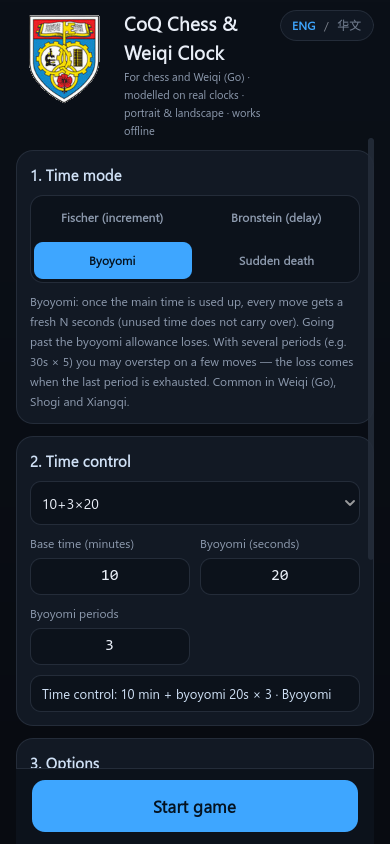
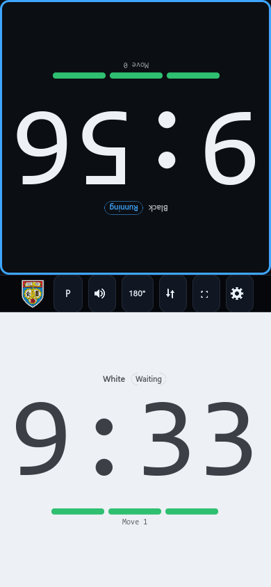
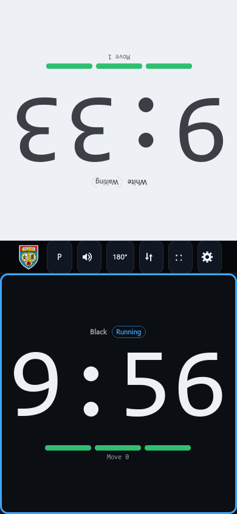
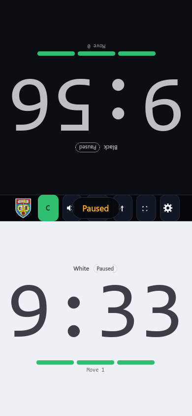
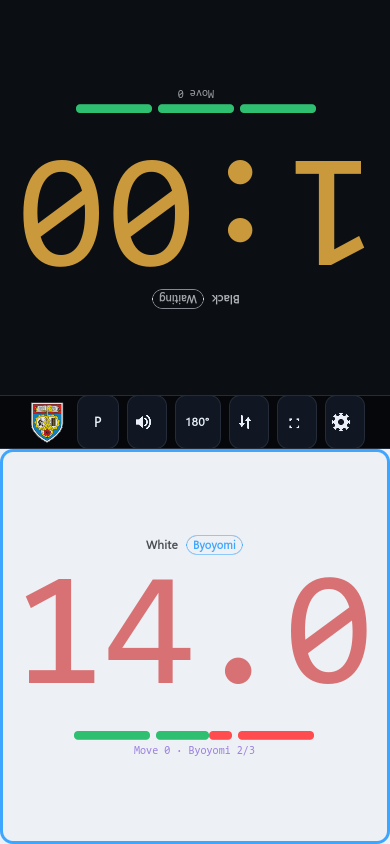
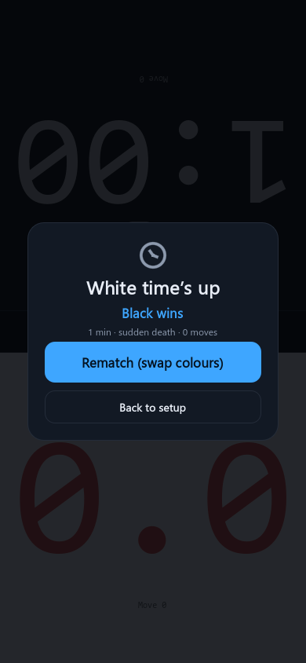

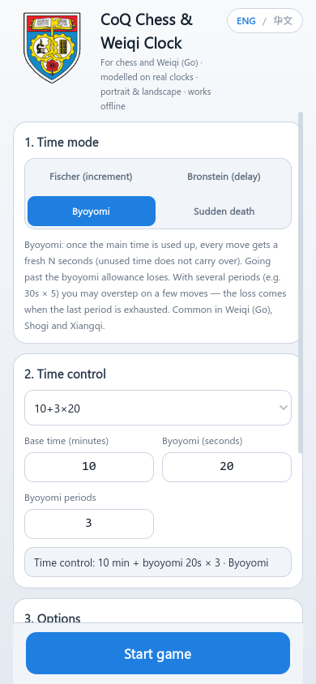
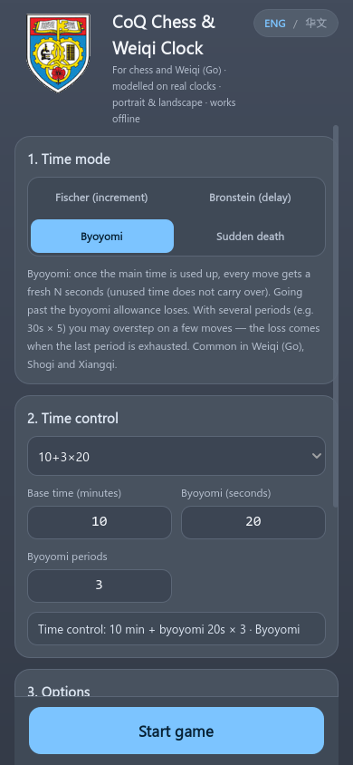
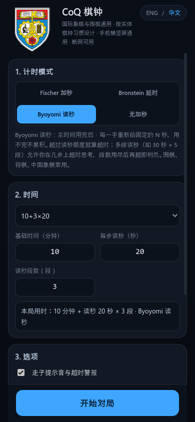
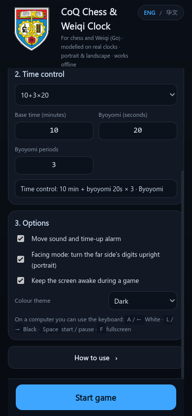
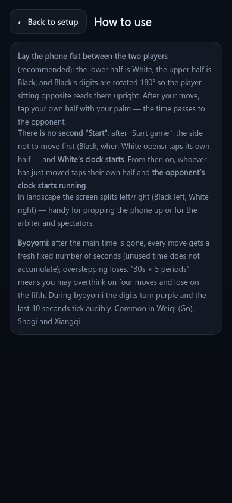
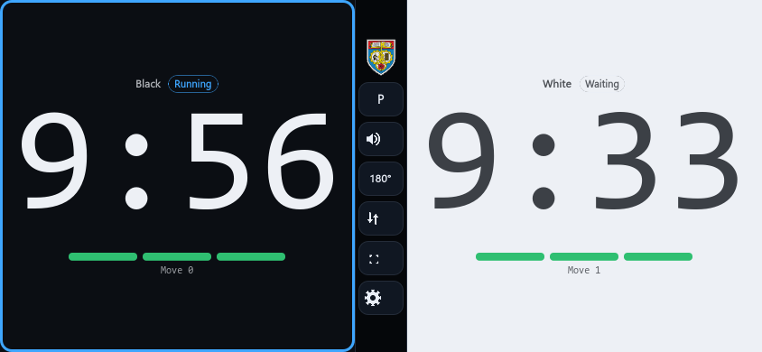

---

## 一、已验证到什么程度（先读这个）

我没有只「写完就交」，凡是这台机器能跑的都真跑了：

| 验证项 | 方法 | 结果 |
| --- | --- | --- |
| 计时语义（加秒 / 延时 / 读秒 / 超时） | `godot --headless --script res://tests/engine_tests.gd`（与网页版一一对应的 31 个用例） | **31/31 通过，220 项断言** |
| 界面交互链路 | `tests/ui_tests.gd`：真的把 `main.tscn` 实例化出来，开表 / 拍钟 / 暂停 / 交换 / 对坐 / 换主题 / 换语言 / 超时 / 再来一局 / 返回设置 / 怎么用页 / 预设下拉框 / 读秒段数条 / 0 时间规则 / 按钮接线 / 存档往返 | **21/21 通过，126 项断言** |
| 与网页版的一致性 | `node tests/project_spec.js` 读 `tests/out/spec_dump.json`，与 `engine.js` / `i18n.js` / `app.js` / `styles.css` 比对 | **417 项全部通过** |
| 资源引用 | 同一个脚本扫描所有 `.gd` 里的 `res://` 路径与工程文件 | 11 处引用全部存在 |
| 界面外观 | `tools/screenshot.ps1`：每种画面跑一次真实渲染并存 PNG（上面嵌了 12 张，脚本一共能出 17 张） | 竖屏 / 横屏 / 三套主题 / 中英双语 / 交换 / 暂停 / 结算 / 确认框均已核对 |
| 排序与旋转规则 | 截图 + `ui_tests`：交换后被旋转的必须是**视觉上第一块** | 与网页版 `.is-far` 同一套规则 |
| **安卓 APK 构建** | `godot --export-debug "Android"` → 27.5 MB APK，再用 `apksigner verify` 与 `aapt2 dump badging` 逐项核对 | **构建成功、签名有效、arm64-v8a、minSdk 24 / targetSdk 35**（详见第二节 C） |
| 导出后的资源 | 同一预设导出 pck，`--main-pack` 跑 120 帧 | 退出码 0，无脚本错误 |

**还没验证的**（需要真机或导出模板，属于你接下来要做的事）：

* **真机上的表现**：手摸上去的手感、返回键、屏幕常亮、横竖屏旋转（APK 已经能出，但本机没有连着手机，
  所以 `adb install` 与实机运行没有验证）；iOS 需要 macOS 才能导出；
* 极端宽高比（如 21:9 竖屏、平板）下的排版；
* 编辑器里首次打开工程时的资源导入（命令行已经能完整跑，编辑器可能提示重建缓存，属正常）。

---

## 二、怎么跑起来

### A. 用 Godot 编辑器（推荐）

1. 装 [Godot 4.5+](https://godotengine.org/download/)（标准版即可，不需要 .NET 版）；
2. 编辑器里 `Import` → 选本目录的 **`project.godot`**；
3. 按 `F5`（或 `Project → Run`）。

### B. 只用命令行

```powershell
# 直接跑（窗口 430×932，可以随意拉伸）
C:\Apps\Godot_451\Godot_v4.5.1-stable_win64.exe --path .

# 跑完所有检查（引擎单测 + 界面测试 + 与网页版比对）
powershell -ExecutionPolicy Bypass -File tests/run_tests.ps1

# 重新拍一遍截图
powershell -ExecutionPolicy Bypass -File tools/screenshot.ps1
```

`tests/run_tests.ps1` 会用 `-Godot <路径>` / `$env:GODOT` / PATH / 常见安装位置 依次找可执行文件，
找不到就报错提示你怎么指定。

### C. 导出成 APK（安卓）/ 其它平台

编辑器里 `Project → Export…` → `Export Project` 即可。命令行等价做法（`export_presets.cfg` 里
已经有一个名叫 `Android` 的预设）：

```powershell
# 桌面 / 网页
godot --headless --path . --export-release "Windows Desktop" build/CoQChessClock.exe
godot --headless --path . --export-release "Web" build/web/index.html

# 安卓 APK（--export-debug 用调试签名，自己装/发给棋友最省事）
godot --headless --path . --export-debug "Android" build/CoQChessClock-debug.apk
# 正式签名（要先在预设里配 release keystore）
godot --headless --path . --export-release "Android" build/CoQChessClock.apk
# 上架 Google Play 必须是 AAB
godot --headless --path . --export-release "Android" build/CoQChessClock.aab
```

**已在本机真跑过一遍**（Godot 4.5.1 + JDK 17.0.20 + Android SDK 35）：

| 验证项 | 结果 |
| --- | --- |
| 构建 | `--export-debug` 退出码 0，产出 `build/CoQChessClock-debug.apk` |
| 大小 / ABI | **27.5 MB**，只含 `arm64-v8a`（预设里关掉了 armv7/x86） |
| 清单（`aapt2 dump badging`） | `package=com.example.coqchessclock`、`versionName=1.0.0`、`minSdk=24`、`targetSdk=35`、`launchable-activity=com.godot.game.GodotApp`、自适应图标已生成 |
| 签名（`apksigner verify`） | 通过，`CN=Godot, OU=Godot Engine, O=Stichting Godot`（Godot 自带的调试证书） |
| 包内容 | `lib/arm64-v8a/libgodot_android.so` + `libc++_shared.so` + 全部游戏资源；`tests/` 已按预设排除（0 条目） |
| 导出后的资源能否跑 | 同一预设导出 pck，再 `--main-pack` 跑 120 帧：退出码 0，无脚本错误 |

换一台机器从头装时要四样东西：

1. **OpenJDK 17**（Temurin 17；只有 JRE 或 Java 8 不行，Gradle 要 `javac`）；
2. **Android SDK**：`platform-tools`、`build-tools;35.0.0`、`platforms;android-35`、`cmdline-tools;latest`
   —— 不用装整个 Android Studio：

   ```powershell
   powershell -ExecutionPolicy Bypass -File tools/install-android-sdk.ps1             # 最小集，约 260 MB
   powershell -ExecutionPolicy Bypass -File tools/install-android-sdk.ps1 -IncludeNdk # 连 NDK/CMake，约 1.2 GB
   ```

   （NDK r28b / CMake 3.10.2 只有走 Gradle 自定义构建时才用得到，纯出 APK 可以不装。）
3. 编辑器 `Editor Settings → Export → Android`：`Java SDK Path` 指 JDK 17、`Android Sdk Path` 指 SDK
   （Windows 常见 `%LOCALAPPDATA%\Android\Sdk`）；
4. 导出模板：`Editor → Manage Export Templates → Download`（版本必须与编辑器一致，本机是 `4.5.1.stable`）。

装到手机：`adb install -r build/CoQChessClock-debug.apk`，或把 APK 拷进手机点开装（需允许「安装未知来源」）。

#### 真的踩到的坑：一条**完全空白**的配置错误

第一次导出时 Godot 只打印：

```
ERROR: Cannot export project with preset "Android" due to configuration errors:
```

冒号后面什么都没有；`--verbose`、`--log-file`、换预设、换选项、甚至新建一个空工程都一样。
根因是工程里少了 **ETC2/ASTC 纹理压缩**（安卓 GPU 的格式），而 Godot 的检查
`has_valid_project_configuration()` 在 headless/CLI 下**忘了往错误字符串里写内容** ——
已知 bug：[godotengine/godot#123504](https://github.com/godotengine/godot/issues/123504)
（GUI 里有单独提示，所以只有命令行 / CI 会踩）。

`project.godot` 里补上这一行即可（已加，并留了注释）：

```ini
[rendering]
textures/vram_compression/import_etc2_astc=true
```

改完要重新导入一次（`godot --headless --path . --import`），让纹理生成 ETC2/ASTC 变体。

#### 其它几条

* **签名**：调试包用 Godot 自带的 debug keystore（`%APPDATA%\Godot\keystores\debug.keystore`）；
  正式包要在预设里填 release keystore（当前 keystore 与 key 的密码必须相同）。
* **包名**：预设里现在是 `com.example.coqchessclock`，正式发布前改成自己的；改完手机上已装的旧包必须先卸载
  （签名不同会报 *Could not install to device*）。
* **体积**：27.5 MB 里 `libgodot_android.so` 未压缩就有 72.5 MB（压缩后约 25 MB）。
* **测试不打进包**：预设的 `exclude_filter="tests/*"`，否则 `engine_tests.gd` / `ui_tests.gd` /
  `spec_dump.json` 会一起上手机。
* **图标**：`assets/icon.png` 已是 **512×512**（启动器要求 ≥192），`aapt2` 显示已生成自适应图标。
* **返回键**：先收结算层 → 再回设置（对局中弹确认框）→ 最后才退出，不会一按就丢掉正在下的棋。
* **屏幕常亮**：走 `DisplayServer.screen_set_keep_on()`，安卓上就是 `FLAG_KEEP_SCREEN_ON`。
* **横竖屏**：`window/handheld/orientation=6`（跟随传感器），转屏后按 844×390 重新排版。

竖屏是默认方向，横屏时界面左右分屏、两块面板不旋转（与网页版一致）。

### D. 运行期开关（都是给自动化用的）

| 开关 | 作用 |
| --- | --- |
| `--shot=menu\|menu-bottom\|help\|clock\|clock-byoyomi\|clock-swapped\|clock-paused\|overlay\|confirm` | 摆好某个画面、存一张 PNG、退出（`tools/screenshot.ps1` 用的就是它） |
| `--shot-out=<路径>` | 截图的落盘位置（默认 `user://shot.png`） |
| `--lang=zh\|en` | 强制界面语言（相当于网页版的 `?lang=zh`） |
| `--theme=light\|medium\|dark` | 强制主题（相当于 `?theme=light`） |
| `--autostart` | 跳过设置页，直接按当前设置开一局 |
| `--demo-quick` | 把用时改成 1 分钟无加秒（验证超时结算层时不用等 10 分钟） |
| `--demo-swapped` | 打开「交换两侧」 |
| `--reset-settings` | 忽略存档、回到首次启动的默认值（不写回存档） |
| `--debug-input` | 把启动参数、布局尺寸、以及一条「界面自检」（预设下拉框 / 怎么用入口是否存在）打进日志——导出成 PCK/APK 之后也能用它验证打包内容 |

用法：`godot --path . -- --lang=zh --shot=menu --shot-out=out.png`（`--` 之后的参数才是给游戏的）。

### E. 存档与「回到出厂设置」

设置存在 `user://chessclock_settings.json`（Windows 上是
`%APPDATA%\Godot\app_userdata\CoQ Chess & Weiqi Clock\`）。字段与网页版
`localStorage` 里的 `chessclock.settings.v1` **同名同义**：`mode / baseMin / incSec / periods /
presetId / sound / facing / swapped / keepAwake / lang / theme`。

想回到出厂默认（英文 / 读秒 / 10+3×20 / 深色）：删掉那个文件，或用 `--reset-settings` 启动一次。

---

## 三、操作方式

**没有「开始」按钮** —— 开局和实体棋钟一样，靠拍面板。

| 操作 | 说明 |
| --- | --- |
| 开局：拍**对侧**那半屏 | 白先走，所以拍**黑方**那一侧 → **白方的钟开始走**；这一下**不算步数**（两边仍是 0/0） |
| 拍自己那半屏 | 走完一手：时间立刻交给对方（拍非走棋方不产生任何效果） |
| 触摸 / 鼠标 | 都是同一个 `Button.button_down`，按下的瞬间就响应（不是松手才响应） |
| `A` / `←` | 白方按键（开局时它 = 让黑方先走） |
| `L` / `→` | 黑方按键（开局时它 = 让白方先走） |
| `空格` / `回车` | 暂停 / 继续（未开表时是空操作） |
| `F` | 全屏 |
| `ESC` | 返回设置（对局中会先弹确认框） |

设置页的「界面主题」是 **浅色 / 中性 / 深色** 三选一（与网页版同一套色值、同一套语义：
两块对局面板始终「黑方深、白方浅」，那是游戏语义，不随主题变），选择会存进存档。

中间操作条（与网页版同序）：**`P` / `C`**（暂停 / 继续，**未开表时整颗隐藏**）、
声音图标（开 / 关两态）、**`180°`**（对坐）、**交换两侧图标**（两块面板对调）、
全屏图标、齿轮图标（返回设置）。

* **对坐模式**：默认开启，**视觉上第一块**（竖屏默认上半屏 = 黑方）整体旋转 180°，
  坐在对面的选手看到的是正的；手机平放两人对坐时就这样用。竖屏有效，横屏不转（横屏两边在同一视线里，
  转任何一块都会让另一边倒过来）。
* **交换两侧**：只交换两块面板在屏幕上的**位置**，不改朝向；旋转永远跟着「视觉上第一块」走，
  所以交换后被旋转的是另一块（与网页版 `.is-far` 同一套规则）。这个选择会存进存档。
* **两个时间可以为 0**：读秒模式下**基础时间**与**读秒秒数**各可以是 0（但不能同时是 0）——
  0 主时间 = 纯读秒（钟上直接从读秒那一格开始），0 秒读秒 = 只有主时间、用完即负（段数条隐藏）；
  两个都是 0 时按 1 分钟主时间兜底，其它模式的主时间仍是 1–180 分钟。
* **读秒阶段**：数字转紫，步数行显示剩余段数（`Byoyomi 2/3`），最后 10 秒每秒滴答一次（主时间阶段同样如此，四种模式通用）；
  **数字与步数行之间还有一条分段指示条**（`ByoyomiBar`，纯 `_draw` 绘制）：一段 = 一段读秒，
  **绿 = 还没用、红 = 已经用掉**（用主题里的 ok / danger 两色）；正在倒计时的那一段按本窗口剩余比例由绿变红（剩 5/20 秒 → 75% 红），
  主时间阶段整条都是绿的；只在 Byoyomi 模式出现，对坐时跟着面板一起转。
* **超时**：停表 + 警报音 + 结算层（`再来一局` / `返回设置`）。
* **暂停**：两块面板中间出现「暂停」提示，时间冻结（暂停时拍钟无效）。

---

## 四、目录结构与架构

```
Godot/
├── project.godot              工程配置（竖屏 390×844 设计基准、canvas_items 拉伸、gl_compatibility、ETC2/ASTC、入口场景）
├── export_presets.cfg         导出预设：Android（APK / arm64-v8a / 不含 tests）、桌面、网页
├── assets/
│   ├── logo-brand.png         设置页图标 288×288（与网页版同一张原图）
│   ├── logo-strip.png         操作条图标 144×144
│   ├── icon.png               应用图标 512×512（安卓启动器要求 ≥192）
│   ├── icons/*.png            操作条图标：声音开/关、交换、设置、全屏（白色 + 透明底，按主题染色）
│   └── sounds/*.wav           走子音 / 读秒滴答 / 超时警报（16-bit PCM，与 Defold 版同一套合成音）
├── logic/
│   ├── engine.gd              ★ 计时引擎：纯逻辑、时间由外部注入（与 engine.js 等价）
│   ├── i18n.gd                ★ 双语文案表（164 条 × 2，与 i18n.js 逐字相同）
│   ├── theme.gd               ★ 三套配色 + 由配色生成 Godot Theme 资源（对应 styles.css 的变量块）
│   ├── settings.gd            存档读写 + 设置 ↔ 引擎配置换算
│   └── presets.gd             19 档预设（棋类 11 / 读秒 8，与 app.js 逐档相同）
├── ui/
│   ├── main.tscn              根场景（一个 Control + main.gd，其余界面在代码里搭）
│   ├── main.gd                总控：状态、界面切换、计时循环、声音、屏幕常亮、全屏、截图模式、命令行参数
│   ├── setup_view.gd          设置页：模式 / 时间预设下拉框 / 时间输入 / 选项 / 主题 / 语言 / 「怎么用」入口
│   ├── help_view.gd           「怎么用」说明页（设置页里那个入口点进来的）
│   ├── clock_view.gd          棋钟页：两块面板 + 操作条 + 对坐旋转 + 交换 + 字号自适应 + 读秒段数条
│   ├── byoyomi_bar.gd         读秒段数条（_draw 绘制）：绿 = 还剩、红 = 已用，倒计时段按比例变红
│   ├── overlay_view.gd        超时结算层 / 返回确认框
│   ├── clock_face_icon.gd     结算层那个小钟面（用代码画，不用 emoji）
│   └── ui_kit.gd              建控件的小工具（对应 CSS 的那些规则）
├── tests/
│   ├── engine_tests.gd        ★ 31 个计时用例（与 tests/engine.test.js 一一对应）
│   ├── ui_tests.gd            ★ 21 个界面集成用例（无头跑真实场景）
│   ├── dump_spec.gd           把关键数据导出成 JSON，供 Node 与网页版比对
│   ├── project_spec.js        ★ 与网页版逐个比对（常量 / 文案 / 预设 / 默认值 / 色值 / 资源）
│   ├── run_tests.ps1          一键测试入口
│   ├── out/spec_dump.json     对照数据（生成物）
│   └── screenshots/           截图产物（上面那些图）
└── tools/
	├── export-icons.js        生成操作条图标（纯 Node 光栅化，96×96 白色 PNG）
	├── screenshot.ps1         用截图模式把每种画面拍一遍
	└── install-android-sdk.ps1 装 Android SDK（cmdline-tools 路线，不用装 Android Studio）
```

### 界面为什么是「代码搭」而不是一堆 .tscn

网页版本来就是一个 `app.js` 管全部 DOM。移植时如果照搬成几十个 .tscn 节点，
**语言、主题、横竖屏、面板交换**这四件事都要在运行时重排，反而每一处都得回到编辑器里连线。
所以这里只在 `main.tscn` 里放一个根 Control，其余控件由三个 View 类的 `build()` 现搭：

* 颜色 / 字号 / 内距全部走 **Godot Theme 的 type variation**（相当于 CSS class），
  换主题只是把一个新的 `Theme` 资源挂到根节点上，所有子控件自动重绘 —— 与网页版「换一组 CSS 变量」同构；
* 文案全部走 `ClockI18n.t()`，`refresh_language()` 一次性刷新，所以词条与网页版可以逐字相同。

### 计时为什么不会算错

和网页版一样：**不做 `delta` 累加**，也不信任帧率。每帧只是用
`ClockEngine.readout(state, side, Time.get_ticks_msec())` 重新推算，所以掉帧、窗口被拖动、
被切到后台、甚至引擎被系统暂停，时间与超时判定都仍然正确 —— `engine_tests.gd` 里有
「挂起 30 分钟后仍能判出正确超时方」的用例。

### 屏幕方向与缩放

设计基准是 **390×844（竖屏手机 dp）**，横屏时把虚拟画布换成 **844×390**（`main.gd` 的
`_update_content_scale()`）。这样 1 个设计单位在两种方向下都约等于 1 dp；
如果只用一套 390×844 的基准，Godot 的 `canvas_items + expand` 会在横屏把整个界面缩到一半以下。

---

## 五、测试

```powershell
powershell -ExecutionPolicy Bypass -File tests/run_tests.ps1     # 全部（推荐，约 20 秒）
```

拆开跑：

```powershell
# 计时引擎（31 个用例，不需要窗口）
godot --headless --path . --script res://tests/engine_tests.gd

# 界面集成（21 个用例，不需要窗口）
godot --headless --path . --script res://tests/ui_tests.gd

# 与网页版逐个比对（需要先跑 dump_spec.gd 生成 tests/out/spec_dump.json）
godot --headless --path . --script res://tests/dump_spec.gd
node tests/project_spec.js

# 截图
powershell -ExecutionPolicy Bypass -File tools/screenshot.ps1
powershell -ExecutionPolicy Bypass -File tools/screenshot.ps1 -Only clock,overlay
powershell -ExecutionPolicy Bypass -File tools/screenshot.ps1 -Only menu -Theme light -Lang zh
```

`project_spec.js` 检查的是「手写移植时最容易犯的错」，也是这次真的踩过的坑：

1. `engine.gd` 与 `engine.js` 的 8 个常量、4 个模式名、模式标签是否逐个一致；
2. `i18n.gd` 与 `i18n.js` 的 key 集合与每个值是否逐字相同（允许原生版多出确认框两条）；
3. 预设档位（棋类 11 / 读秒 8）的 `baseMin / incSec / periods / sub / name` 是否逐档相同，
   以及按钮上的记法（`10+5` / `10+3×20`）是否一致；
4. 默认设置的 10 个字段是否与 `app.js` 的 `DEFAULTS` 相同；
5. 三套主题的 81 个色值是否与 `styles.css` 的 CSS 变量逐个相同（`#000` 会展开成 `#000000` 再比）；
6. 工程文件里的主场景、图标、音效是否存在，以及**所有代码里 `res://` 引用的资源是否真的存在**
   —— 路径拼错在 Godot 里不会报错，只会显示一片空白。

---

## 六、常见修改点

| 想改什么 | 改哪里 |
| --- | --- |
| 计时规则（加秒/延时/读秒/超时） | `logic/engine.gd`，然后 `tests/run_tests.ps1` 必须仍然是 31/31、417/417 |
| 新增一种计时模式 | 上面两处 + `ui/setup_view.gd` 的模式按钮列表 + `i18n.gd` 的词条 |
| 配色 | `logic/theme.gd` 的三份调色板（与 `styles.css` 一一对应，改完跑 `project_spec.js` 会告诉你哪里对不上） |
| 界面文案 / 加第三种语言 | `logic/i18n.gd`（加一份同 key 的表 + 加进 `LANGS`），再在 `setup_view.gd` 的语言胶囊里加一颗按钮 |
| 首次启动的默认值 / 存档字段 | `logic/settings.gd` 的 `DEFAULTS`（测试会与网页版 `app.js` 比对） |
| 预设档位 | `logic/presets.gd`（测试会与网页版逐档比对） |
| 操作条图标 | 改 `tools/export-icons.js` 里的形状 → `node tools/export-icons.js` |
| 品牌图标 / 安卓启动器图标 | 与网页版**共用同一张原图** `../assets/logo-source.png`：换图后跑 `node ../tools/export-icons.js`，再把 `logo-brand.png` / `logo-strip.png` 复制过来；`assets/icon.png`（512×512）也照原图重新居中缩放一次 |
| 音效 | 换 `assets/sounds/*.wav`（16-bit PCM）。Defold 版有 `tools/make_sounds.py` 可以重新合成 |
| 窗口大小 / 设计基准 | `project.godot` 的 `display/window/size/*` 与 `ui/main.gd` 的 `_update_content_scale()` |
| 排版细节（字号/间距） | `logic/theme.gd` 里对应 type variation 的 `font_size` / 内容边距 |

---

## 七、与网页版的有意差异

移植不是逐字抄，下面这些是**刻意**不同的，其余行为都保持一致：

| 项目 | 网页版 | Godot 版 | 原因 |
| --- | --- | --- | --- |
| 按钮上的 emoji（🔊 🔇 ⇵ ⛶ ⚙） | emoji / 几何字符 | `assets/icons/*.png` + 按主题染色 | Godot 内置字体没有这些码位，彩色 emoji 又没法染色 |
| 结算层的大图标（⏱） | emoji | `clock_face_icon.gd` 用代码画 | 同上，emoji 是彩色位图，和扁平配色不搭 |
| 「返回设置」确认 | `window.confirm()` | 自绘确认卡（主按钮是**继续对局**） | 原生端没有浏览器对话框；顺手把误触的方向调安全了 |
| 暂停提示的文案 | CSS 里写死「已暂停」 | `i18n.gd` 的 `chip.paused` | 网页版那处是个小 bug（英文界面也显示中文），这里做对 |
| 屏幕常亮 | Wake Lock API | `DisplayServer.screen_set_keep_on()` | 平台 API 不同 |
| 全屏 | Fullscreen API | `DisplayServer.window_set_mode()` | 同上 |
| 安卓返回键 | 浏览器没有这个键 | `main.gd` 的 `_notification`：先收结算层 → 再回设置（对局中弹确认框）→ 最后才退出 | Android 默认一按就退，对正在下的棋是灾难；`ui_tests` 里有对应用例 |
| 语言 / 主题的强制方式 | `?lang=zh` / `?theme=light` | `--lang=zh` / `--theme=light` | 没有地址栏 |
| 设置存储 | `localStorage` | `user://chessclock_settings.json`（字段同名） | 平台存储不同 |
| 字号自适应 | `getBoundingClientRect` 实测文本宽度 | `Font.get_string_size` 实测文本宽度 | 同一套公式，只是换了测量 API |
| 界面搭建 | HTML 结构 + CSS | GDScript 建控件 + Theme 变体 | 见上面「界面为什么是代码搭」 |

> **三端现在一致的界面决策**（本轮把网页版与 Defold 版也改齐了，所以不再是差异）：
> 「2. 时间」的预设是**下拉框**（一档一行「10+3×20」（棋类是「10+5 · Rapid」），最后一档「自定义」），
> 「怎么用」搬到**单独一页**、设置页底部留「怎么用 ›」入口。
> `preset.custom`（自定义 / Custom）现在三端都有，因此在 `tests/project_spec.js` 里也只是普通词条。
>
> 另外三端都加了**读秒段数条**（数字与步数行之间，一段一格，绿 = 还剩、红 = 已用）：Godot 是 `ui/byoyomi_bar.gd`
> （`_draw` 纯绘制），网页是 `.byo-bar` + 每段一个 `<i>`，Defold 是每块面板 20 个 box 按布局缩放。

也**没有**照搬、但值得知道的：

* 网页版的 `_scene-*.html` 截图页与 `tests/visual/` 是浏览器虚拟时间那套工具，这里换成了
  `--shot=…` 运行期截图（见 `tools/screenshot.ps1`）；
* 网页版用 `beforeunload` 拦「关页面」，原生端没有这回事（窗口关了就是关了），只在「返回设置」时确认。

## Licence

MIT，与网页版一致。
